# CloudFormation Assignment — [Cassiana de Oliveira] (L00188357)

## 📋 Assignment Overview

This repository contains my individual solution for the CloudFormation assignment.
It covers:
- **Part A(a):** A static website hosted on Amazon S3, created via CloudFormation, with my name and Lnumber as the header.
- **Part A(b):** A three-tier architecture (Web tier, Application tier, Database tier) built with CloudFormation.
- **Part B:** Best practices applied — security, scalability, performance, and commented code throughout.

---

## 📚 Research & Learning Resources

The following resources were used during the research phase of this assignment.

### YouTube Videos
- [AWS CloudFormation Explained | Deploy Infrastructure as Code](https://youtu.be/iasdbb6p2so?si=A5VtGmxe9cN-K-lG) — introductory overview of Infrastructure as Code (IaC) and AWS CloudFormation.
- [Part-28 || AWS CloudFormation Tutorial for Beginners | Step-by-Step Infrastructure as Code (IaC)](https://www.youtube.com/watch?v=6jFLpf0aDg0) - Tutorial of AWS CloudFormation.

### Official Documentation
- [AWS CloudFormation](https://docs.aws.amazon.com/AWSCloudFormation/latest/UserGuide/Welcome.html)
- [AWS Lambda & IaC Foundation](https://docs.aws.amazon.com/lambda/latest/dg/foundation-iac.html)
- [Hosting a Static Website on Amazon S3](https://docs.aws.amazon.com/AmazonS3/latest/userguide/WebsiteHosting.html)

### LLM Assistance Declaration
As per the assignment brief, I declare the following use of LLMs:
- **Tool used:**  DeepSeek (planning and conceptual explanations) and Claude (troubleshooting AWS CLI issues and generating the initial YAML skeleton)
- **Purpose:** Used for conceptual explanations (what is YAML, what is a three-tier architecture), planning the study timeline, and helping me understand AWS documentation.
- **Prompt asked Claude on 18th October 2026:** 
Write a skeleton static-website.yaml with only the top-level sections: AWSTemplateFormatVersion, Description, Parameters, Resources, Outputs — leave them empty or with placeholders.
- **Prompt asked Claude on 31st October 2026:** 
1) is this yaml file good enough to fufill part A-b of this assignment? 
2) “yes please”, in reply to the offer of a revised template

---

## 🏗️ Part A(a): Static Website on S3

🔗 **Live Website URL:** https://d1hseph1mrdj8x.cloudfront.net/

This section uses a CloudFormation template (`static-website.yaml`) to deploy a secure, public-facing static website. The S3 bucket is kept private, and content is delivered globally via Amazon CloudFront using Origin Access Control (OAC).

**How to deploy (AWS Console):**
1. Open the **AWS CloudFormation** console and click **Create stack** (With new resources).
2. Under "Prepare template", select **Upload a template file** and upload `static-website.yaml`.
3. Name the stack (e.g., `my-static-website`), set the parameters (`ProjectName=static-site`, `Environment=dev`), and click through to create the stack.
4. Wait for the status to change to `CREATE_COMPLETE`.
5. Open the **Amazon S3** console, find the newly created bucket, and **Upload** the `index.html` file.
6. Go to the **CloudFormation Outputs** tab to find the live `WebsiteURL`.

## 🏗️ Part A(b): Three-Tier Architecture

 My first version (`three-tier.yaml`) was my own attempt. I asked Claude to review it, and it identified several problems (no targets registered with the load balancer, no NAT for the private subnets, a region-specific AMI, SSH open to the internet). Claude then generated a revised template, which I typed into `tier.yaml`, committed, deployed and debugged myself. So I decided to use the second version (`tier.yaml`). This allowed me to improve the architecture, resolve design limitations and apply more AWS best practices.
Both versions are based on a three-tier architecture (Web Tier, Application Tier and Database Tier). However, Version 2 provides a more complete separation between the tiers, improved security and better scalability.
One of the main lessons was that creating private subnets alone does not provide the connectivity required by EC2 instances to download software. I needed to configure NAT and routing correctly.
I also learned the importance of registering application instances with load balancer target groups, using Auto Scaling Groups instead of relying on fixed instances, and avoiding unnecessary public access.
I decided to keep Version 1 in the repository because it represents my initial development work and demonstrates how I improved my understanding of AWS CloudFormation throughout the assignment.

Version 2 (`tier.yaml`) is the improved implementation and the version I used as my final three-tier architecture submission.

- The **web tier** (nginx) sits in public subnets behind the internet-facing ALB. It serves `/health` locally and reverse-proxies everything else to the internal ALB.
- The **app tier** (a tiny Python `http.server` on `:8080`) sits in private subnets behind the internal ALB. Its `/db` endpoint opens a TCP socket to RDS:3306 to check network connectivity to the database.
- The **database tier** is a private RDS MySQL instance reachable only from the app tier's security group.

### Deployment model

- **Two Auto Scaling Groups** (web and app), each with a target-tracking CPU policy at 50%, ELB health checks, and 300-second grace periods.
- **Rolling updates** configured with `AutoScalingRollingUpdate` (min 1 instance in service, batch size 1, 2-minute pause).
- **NAT Gateway** in `PublicSubnet1` so private instances can reach the internet for `dnf update` and SSM — without being reachable from it.
- **No SSH anywhere.** Administrative access is via **SSM Session Manager** using the `AmazonSSMManagedInstanceCore` managed policy and the instance profile attached to both launch templates.

**How to deploy (AWS Console):**
1. Open the **AWS CloudFormation** console and click **Create stack** (With new resources).
2. Upload `tier.yaml`.
3. Set parameters: `Environment` (`dev` / `test` / `prod`), `InstanceType`, `MinSize`, `MaxSize`, `DBInstanceClass`.
4. Acknowledge the IAM capability (`CAPABILITY_IAM`) — required because the template creates an IAM role and instance profile.
5. Create the stack and wait for `CREATE_COMPLETE` (takes ~10–15 minutes).
6. Open the **Outputs** tab. Browse to `LoadBalancerURL` and append `/db` to verify app-to-database connectivity (`Database reachable from app tier`).
7. To inspect instances without SSH, use **Systems Manager → Session Manager**.

### Outputs

| Output | What it gives you |
|---|---|
| `LoadBalancerURL` | Public URL of the web tier — try `/` (app page) and `/db` (connectivity test) |
| `InternalAppEndpoint` | Internal ALB DNS (not reachable from the internet) |
| `DatabaseEndpoint` | RDS MySQL endpoint (private) |
| `DatabaseSecretArn` | Secrets Manager ARN holding the auto-generated DB credentials |

---
## ✅ Best Practices Applied

### Part A(a) — Static site

1. **Origin Access Control (OAC):** The basic tutorial approach makes the S3 bucket public. I refactored the code to make the S3 bucket **completely private** and used the modern CloudFront OAC to securely authenticate and read from the bucket.
2. **Encryption & Versioning:** I added Server-Side Encryption (AES256) to the S3 bucket to secure data at rest, and enabled Bucket Versioning to allow for content rollback.
3. **HTTPS Enforcement:** I configured the CloudFront distribution to use `redirect-to-https` and enforced a minimum TLS protocol version (`TLSv1.2_2021`), securing data in transit.
4. **SPA Routing:** I added `CustomErrorResponses` so that 403 and 404 errors redirect to `/index.html` with a 200 status code, which is a best practice for modern static sites.

### Part A(b) — Three-tier

5. **Region-agnostic AMIs:** The AMI is resolved at deploy time via the public SSM parameter `/aws/service/ami-amazon-linux-latest/al2023-ami-kernel-default-x86_64`, so the stack works in any region and always picks the newest Amazon Linux 2023 image. (The original template hard-coded a `us-east-1` AMI ID.)
6. **No SSH, SSM only:** Removed the `KeyName` parameter and the `0.0.0.0/0 → :22` rule. Instances use an IAM instance profile with `AmazonSSMManagedInstanceCore` and are accessed via Session Manager — no inbound management ports, no key pairs to leak.
7. **NAT egress for private subnets:** Added an EIP + NAT Gateway + private route table. Without this, private instances cannot reach the internet for `dnf` updates or the SSM service — a common trap in "minimal" three-tier templates.
8. **Secrets Manager for the DB password:** Replaced the plaintext `DBPassword` parameter with `ManageMasterUserPassword: true`. RDS generates and rotates the master password in Secrets Manager; the ARN is exposed as a stack output.
9. **Tier-chained security groups:** Each tier accepts traffic only from the tier immediately above it — `Internet → PublicALB → Web → InternalALB → App → DB`. No security group accepts traffic from `0.0.0.0/0` except the public ALB on port 80.
10. **Encrypted storage everywhere:** RDS uses `StorageEncrypted: true` on `gp3`. EC2 root volumes are `gp3`, 8 GB, encrypted, with `DeleteOnTermination: true`.
11. **IMDSv2 enforced:** Both launch templates set `MetadataOptions.HttpTokens: required`, which blocks IMDSv1 and mitigates SSRF-style credential theft.
12. **Auto Scaling instead of fixed instances:** Two ASGs with target-tracking CPU policies at 50%, ELB health checks, and rolling update policies — replacing the two hard-coded `AWS::EC2::Instance` resources.
13. **Conditional Multi-AZ for prod:** `MultiAZ: !If [IsProd, true, false]` — dev/test stay cheap, prod gets a standby.
14. **RDS durability:** `DeletionPolicy: Snapshot` and `UpdateReplacePolicy: Snapshot` retain a final snapshot if the stack is deleted. `BackupRetentionPeriod: 1`, `AutoMinorVersionUpgrade: true`, and CloudWatch log exports (`error`, `slowquery`) round it out.
15. **Built-in connectivity check:** The app tier exposes a `/db` endpoint that opens a TCP connection to the RDS endpoint on port 3306. Browsing to `LoadBalancerURL/db` and seeing “Database reachable from app tier” confirms that the request passed through the public ALB, nginx, the internal ALB and the app tier, and that the app tier can reach the database over the network (so the security group rules and routing work). It does not authenticate or run a query, so it tests network connectivity only, not database health.
16. **Load balancer hardening:** The public ALB enables `routing.http.drop_invalid_header_fields.enabled`. Both target groups use `/health` with tuned thresholds and a 30-second deregistration delay for fast rolling updates.
17. **Commented code & UI metadata:** The `tier.yaml` template is sectioned with comment banners per tier and uses `AWS::CloudFormation::Interface` `Metadata` so parameters are grouped logically in the console.

### Non-functional qualities (the ‘ilities’)

**Part A(a) — Static site**
- **Security:** Data is encrypted at rest (AES256) and in transit (TLS 1.2 minimum, HTTPS redirect). The S3 bucket is not publicly accessible; only the specific CloudFront distribution can read it via OAC.
- **Scalability:** Amazon CloudFront is a CDN that automatically scales to handle any amount of traffic. S3 and CloudFront are managed services — no servers to provision or scale manually.
- **Performance:** CloudFront caches the website content at edge locations globally, reducing latency for users regardless of their geographic location.

**Part A(b) — Three-tier**
- **Security:** No SSH; management via SSM. Private subnets have no inbound internet path. Security groups chain strictly tier-to-tier. RDS password managed and rotated by Secrets Manager. Storage encrypted at rest (EBS + RDS). IMDSv2 enforced. Public ALB drops invalid headers.
- **Scalability:** Web and app tiers scale horizontally on CPU (target 50%). The stateless app tier means any instance can serve any request. ASG rolling updates replace instances with minimal disruption.
- **Performance:** Each tier scales independently, so a busy web tier doesn’t force the app tier to grow with it. The web tier uses nginx purely as a lightweight reverse proxy, passing requests to the internal ALB. Traffic between the app tier and the database stays inside the VPC, so it takes a short private network path rather than crossing the internet. Both Auto Scaling Groups use target tracking on average CPU at 50%, which adds instances when load rises and leaves headroom before the instances saturate. Load balancers spread requests across both Availability Zones, and the instances use gp3 volumes.
- **Reliability / operability:** `DeletionPolicy: Snapshot` on RDS; CloudWatch log exports for `error` and `slowquery`; ELB health checks; `/db` connectivity check; parameters grouped in the console.

---

## 📸 Screenshots

### Part A(a): Static Website on S3

#### 1. Stack Creation and Deployment

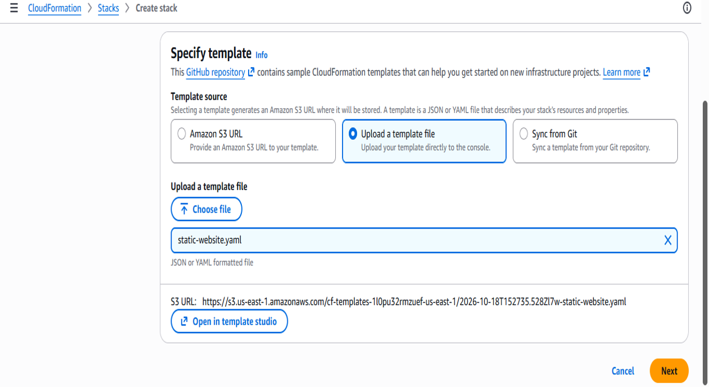

**Uploading the template:** In the CloudFormation `Create stack` wizard, the `static-website.yaml` template is uploaded directly from my computer. The console stores it in an automatically created `cf-templates-...` S3 bucket (shown in the S3 URL), which is separate from the website bucket created by the template.

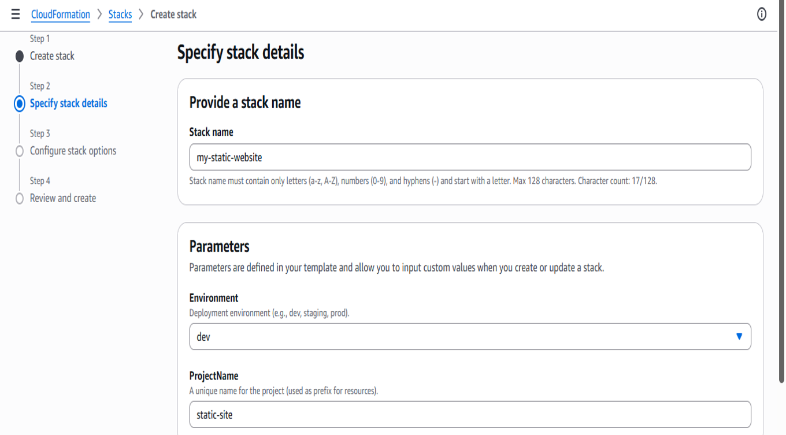

**Specifying stack details:** In step 2 of the `Create stack` wizard, the stack is named `my-static-website` and the template’s parameters are set to `Environment=dev` and `ProjectName=static-site`. The template uses these values to name the AWS resources, which is why the bucket name later begins with `static-site-dev-content`.

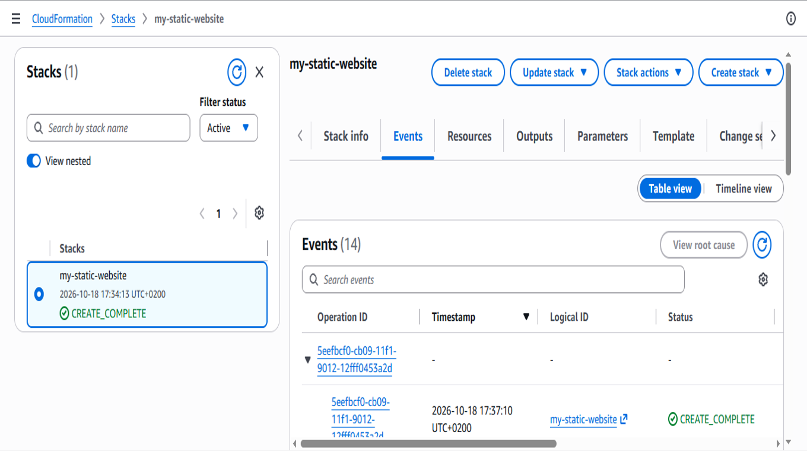

**Successful stack creation:** The `my-static-website` stack reached `CREATE_COMPLETE` on 18 October 2026, about three minutes after creation started. The Events tab records 14 events for the deployment, ending with the stack-level `CREATE_COMPLETE` event.

#### 2. S3 Bucket and website content

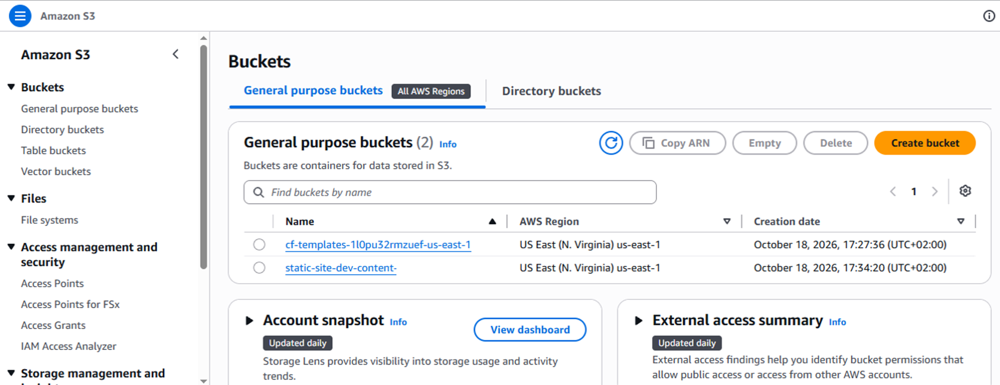

**Verifying the S3 buckets:** The S3 console lists two buckets. `static-site-dev-content-...` is the website bucket created by the `my-static-website` stack seconds after the deployment started. The `cf-templates-...` bucket is created automatically by the CloudFormation console to store the uploaded `static-website.yaml` template, and is not part of the stack.

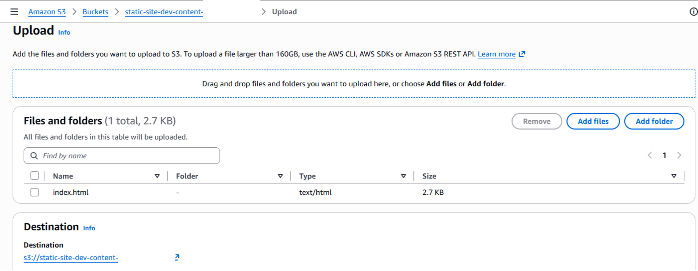

**Uploading the website content:** After the stack was created, I uploaded `index.html` (2.7 KB, `text/html`) to the `static-site-dev-content-...` bucket through the S3 console. This is the static page content that CloudFront serves, stored in S3 as the assignment requires.

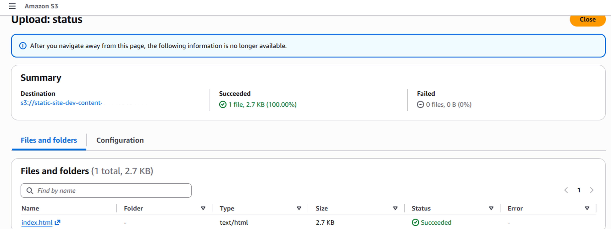

**Confirming the upload:** The S3 upload status page shows `index.html` (2.7 KB, `text/html`) uploaded to the website bucket with no failures. With the content in place, CloudFront can serve the page at the `WebsiteURL`, as shown in the live website screenshot.

#### 3. Bucket privacy

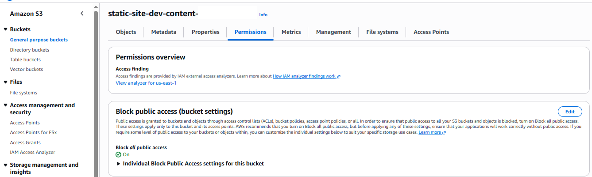

**Verifying the S3 bucket is private:** The bucket’s Permissions tab shows `Block all public access` set to `On`, so the content cannot be read directly from S3. As defined in the template, the only way to reach the files is through the CloudFront distribution, which is granted read access using Origin Access Control (OAC).

#### 4. Stack Outputs and Live Website

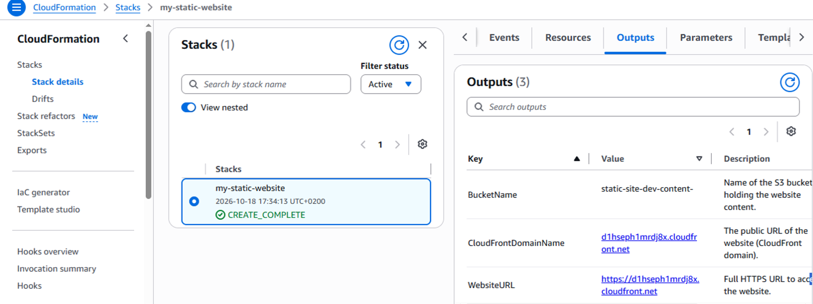

**Verifying the CloudFormation deployment outputs:** The CloudFormation console shows the `Outputs` tab for the `my-static-website` stack. It lists the S3 bucket name (`static-site-dev-content...`), the CloudFront domain name, and the full HTTPS `WebsiteURL`, which is the address opened in the next screenshot.

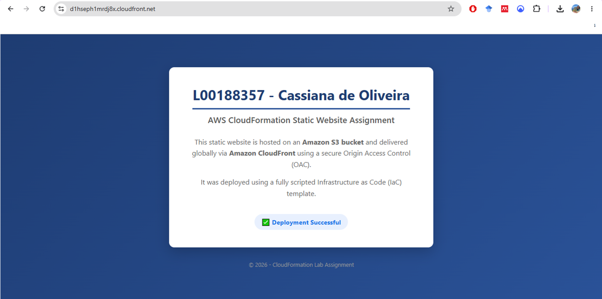

**Verifying the live website:** Browsing to the CloudFront URL (`WebsiteURL` from the previous screenshot) displays the static website, with my L-number and name as the page header, as the assignment requires. The content is stored in the S3 bucket and delivered through CloudFront, which, as defined in the template, reads from the private bucket using Origin Access Control (OAC).

---

### Part A(b): Three-Tier Architecture

#### 1. Issue encountered: failed deployment

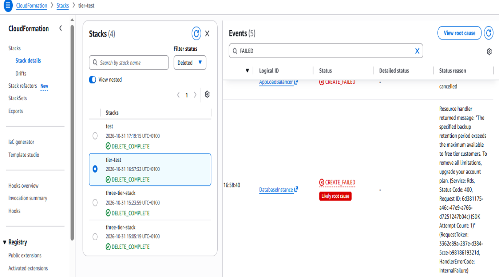

**Fixing the RDS backup retention error:** My earlier attempts with the first version of the template did not deploy correctly, so I moved to the second version (`tier.yaml`). The first deployment of that version (stack `tier-test`) also failed, because RDS rejected a backup retention period of 7 days, which exceeds the maximum allowed on my free-tier account. Several other resources showed “Resource creation cancelled”, but by finding the earliest `CREATE_FAILED` event in the timeline I could separate the real cause from the knock-on cancellations. Changing the value to 1 day allowed the stack to deploy successfully. This taught me to look for the first failure in the event timeline rather than reacting to every failed resource.

#### 2. Successful deployment

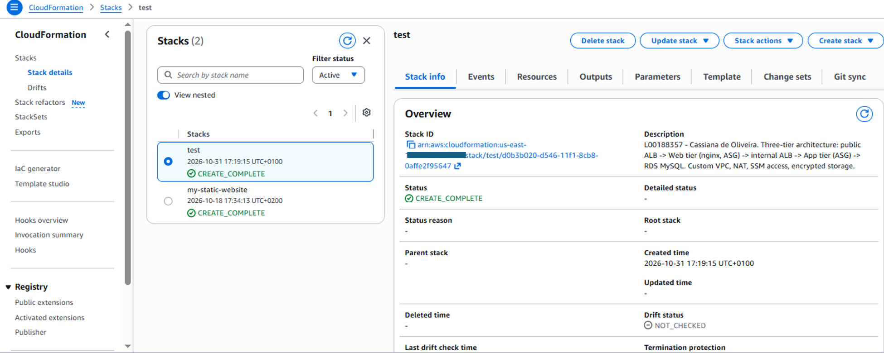 Web tier (nginx, ASG) -> internal ALB -> App tier (ASG) -> RDS MySQL. Custom VPC, NAT, SSM access, encrypted storage.' The status is CREATE_COMPLETE." width="700" />

**Successful deployment:** After changing `BackupRetentionPeriod` from 7 to 1 in `tier.yaml`, the redeployed stack (`test`) reached `CREATE_COMPLETE`. The Description field shows my L-number and name, and the stack created the full three-tier design: public ALB, web tier (nginx Auto Scaling Group), internal ALB, app tier and RDS MySQL.

#### 3. Application and database verification

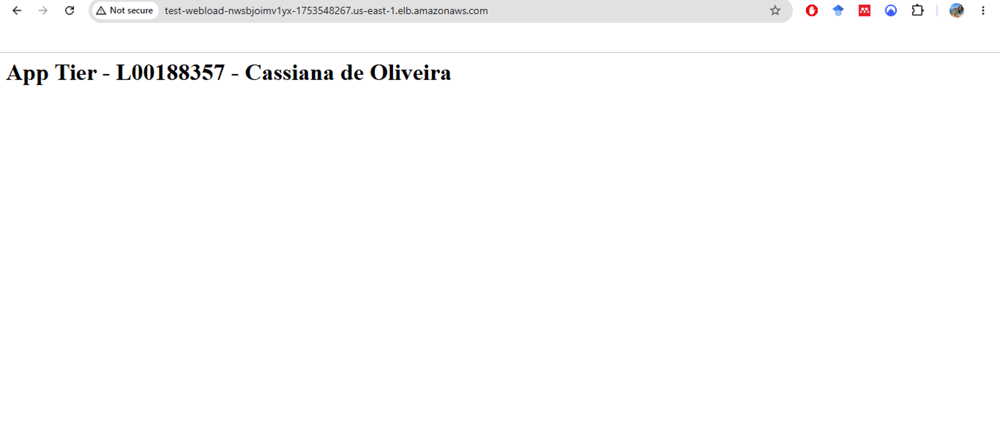

**Verifying traffic through the public and internal load balancers:** Accessing the public ALB URL successfully returns the app tier’s page, displaying my L-number and name. This confirms that the request was correctly routed through the public ALB, handled by the nginx web tier, and forwarded through the internal ALB to reach the app tier.

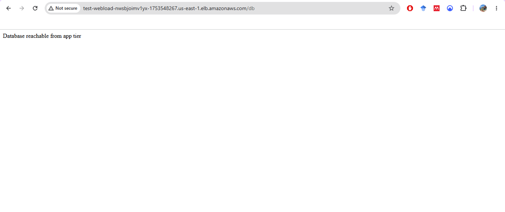

**Verifying network connectivity to the database:** Browsing to the public ALB URL with `/db` added sends the request through the web tier to the app tier, which opens a TCP connection to the RDS instance on port `3306`. The “Database reachable from app tier” message confirms network connectivity between the app and database tiers. The check does not authenticate or run a query, so it verifies connectivity only, not database health.

#### 4. Compute tier: EC2 instances

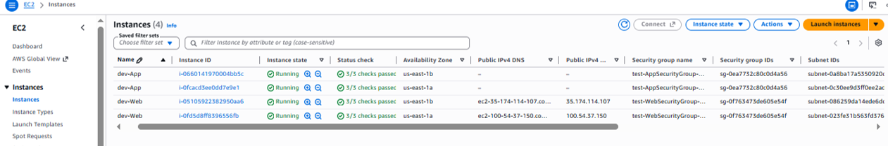

**Verifying the EC2 instances and high-availability setup:** The EC2 console shows four instances, two web and two app, all in a `Running` state and passing their 3/3 status checks. To support high availability, the Auto Scaling Groups launched one instance per tier in each of two Availability Zones (`us-east-1a` and `us-east-1b`). Only the web instances have public IPv4 addresses. The app instances have none, sit in private subnets and only accept traffic from the internal load balancer. Each tier also uses its own dedicated security group (`WebSecurityGroup` and `AppSecurityGroup`), which keeps the tiers separated.

#### 5. Network: subnets and route tables

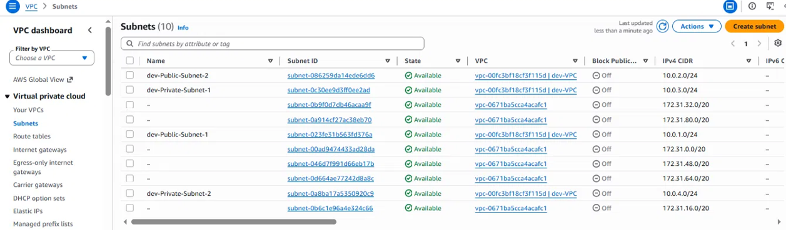

**Verifying the VPC subnet architecture:** The VPC console shows the four subnets created by the template within `dev-VPC`: two public (`10.0.1.0/24` and `10.0.2.0/24`) and two private (`10.0.3.0/24` and `10.0.4.0/24`), spread across two Availability Zones to support high availability (the zones are visible in the EC2 screenshot). The public subnets host the public ALB, NAT Gateway and web tier, while the private subnets host the internal ALB, app tier and RDS instance. These subnet IDs match those seen in the EC2 and RDS screenshots, tying the network design to the running resources. (Note: the other subnets listed belong to the default VPC, not the `dev-VPC` created for this project.)

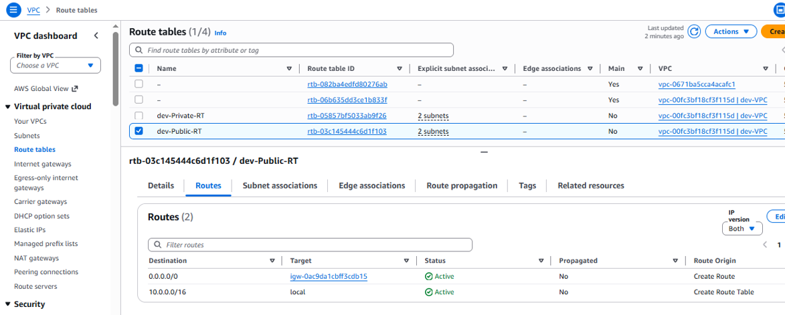

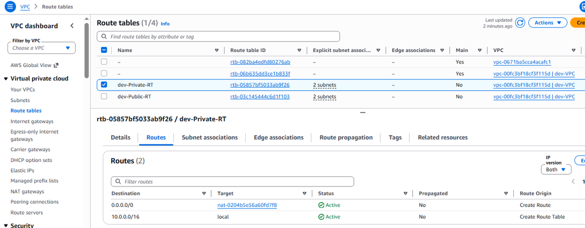

**Verifying the public and private route tables:** The route tables confirm how traffic is directed within `dev-VPC`. The top image shows `dev-Public-RT`, which routes all external traffic (`0.0.0.0/0`) to the Internet Gateway (`igw-`), allowing the public ALB, NAT Gateway and web tier to communicate with the internet. The bottom image shows `dev-Private-RT`, which routes external traffic to the NAT Gateway (`nat-`), so the app tier can make outbound connections for updates and SSM while the private subnets have no inbound path from the internet. Both tables also show the local route (`10.0.0.0/16`) for internal VPC communication.

#### 6. Database tier: RDS

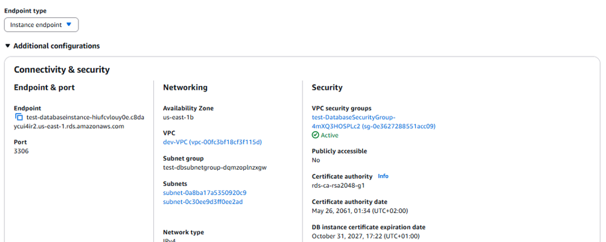

**Verifying the RDS instance’s network and security configuration:** The RDS console shows the database endpoint on port `3306`, the same port the app tier’s `/db` check connects to. The Networking section shows the instance is deployed in the private subnets (`subnet-0a8ba17a5350920c9` and `subnet-0c30ee9d3ff0ee2ad`) within `dev-VPC`, with Publicly accessible set to `No`, so it has no public address. The Security section shows the instance is attached to its own dedicated security group (`test-DatabaseSecurityGroup`), which, as defined in the template, only accepts MySQL traffic from the app tier. This maintains the tier separation seen in the EC2 and subnet screenshots.

---

## 🔗 Important

- **Collaborator:** Ruth.Lennon@atu.ie has been added to this repository.
- **Code commits:** All commits are my own work.
- **Lab write-up:** This README.md serves as my lab write-up.